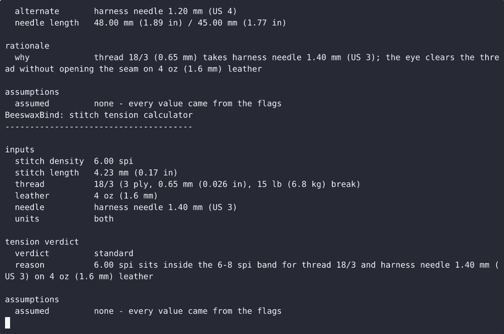
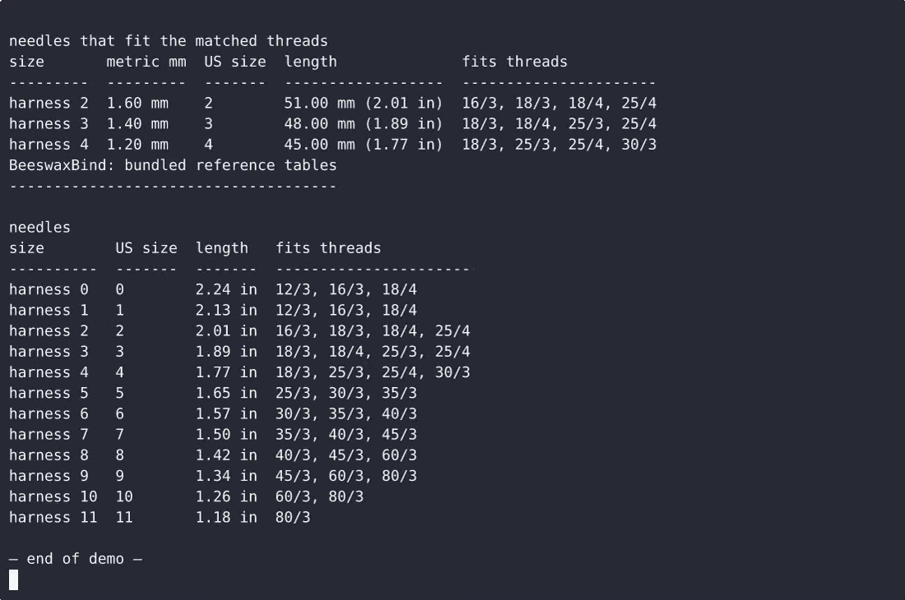

# BeeswaxBind — complete Full-stack app command-line tool example app

Need a self-hosted command-line tool? **BeeswaxBind** is the open-source answer: a Full-stack app project you can clone, run, and own. BeeswaxBind is a single-file, standard-library-only Python command-line tool for leathercraft and saddlery work that does three jobs: recommend harness needle and linen thread sizes for a given thread number and leath…. Every BeeswaxBind line of code is here — no stripped demo, no paywalled features. Apache-2.0-licensed; [remix BeeswaxBind on cenius.ai](https://cenius.ai/marketplace/p/beeswaxbind?ref=gh&utm_campaign=beeswaxbind-webapp) for a bespoke custom version.


[](LICENSE)  [](https://cenius.ai)

[](https://cenius.ai/marketplace/p/beeswaxbind?ref=gh&utm_campaign=beeswaxbind-webapp)

> **▶ [Open & edit in cenius.ai](https://cenius.ai/marketplace/p/beeswaxbind?ref=gh&utm_campaign=beeswaxbind-webapp)** — one click to an editable workspace: describe changes in plain English, get an instant preview, one-click deploy and host. Modifications made on the platform come with full rebrand & relicense rights.

_Local clone? See [Quick start](#quick-start) below. cenius.ai is the zero-setup path._

## Demo


▶ **[Watch the full demo video](https://cenius.ai/marketplace/p/beeswaxbind?ref=gh&utm_campaign=beeswaxbind-webapp)** — the complete walkthrough, playing on the project's cenius.ai page · [MP4 file](.github/media/demo.mp4)

## Screenshots

 

## Quick start

```bash
./install.sh   # installs dependencies + seeds demo data
```

See [`INSTALL.md`](INSTALL.md) for full setup and usage instructions.

## Architecture

Everything runs out of the box: a Full-stack app codebase (13 files). Dependency management and data seeding are both handled by `./install.sh` — run it once, then start the server. Top-level layout: `examples/`, `tests/`. Installation walkthrough: [`INSTALL.md`](INSTALL.md).

## Features

- Needle and thread size recommender
- Stitch tension calculator
- Wax blend ratio helper
- Interactive prompt fallback
- Bundled leathercraft reference tables
- Input parsing and validation
- Output formatting: aligned text and --json

## Usage guide

Every example below is a real, copy-pasteable command. `python3 beeswaxbind.py`
can be shortened to `beeswaxbind` if you ran `bash install.sh`.

### 1. Which harness needle carries my thread?

```bash
python3 beeswaxbind.py needle --thread 18/3 --leather 4oz
```

```
inputs
  thread          18/3 (3 ply, 0.65 mm (0.026 in), 15 lb (6.8 kg) break)
  leather         4 oz (1.6 mm)
  units           both

recommendation
  primary         harness needle 1.40 mm (US 3)
  alternate       harness needle 1.20 mm (US 4)
  needle length   48.00 mm (1.89 in) / 45.00 mm (1.77 in)

rationale
  why             thread 18/3 (0.65 mm) takes harness needle 1.40 mm (US 3); the eye clears the thread without opening the seam on 4 oz (1.6 mm) leather
```

* The **primary** needle is the closest fit for the thread's diameter, with a
  small allowance that grows with leather weight; the **alternate** is the next
  bracket, for when the eye is tight or the leather is unforgiving.
* Leather weight accepts ounces (`4oz`, `6`) or thickness (`2mm`, `1.6mm`) and
  must be between 2 and 20 oz (0.8–8 mm). Given millimetres, the ounce equivalent
  is printed next to it, and vice versa.
* With no `--leather`, 4 oz is assumed and the assumption is printed:

```bash
python3 beeswaxbind.py needle --thread 25/3
## assumptions
##   assumed         4 oz leather assumed (default)
```

* One system only, for a workshop note:

```bash
python3 beeswaxbind.py needle --thread 18/3 --units metric     # 1.40 mm, 1.20 mm
python3 beeswaxbind.py needle --thread 18/3 --units imperial   # US 3, US 4
```

_Full guide: [`USAGE.md`](USAGE.md)_

## FAQ

### How do I run BeeswaxBind on my own server?

Everything you need ships in this repo: clone it, run `./install.sh` to install dependencies and seed demo data, then follow [`INSTALL.md`](INSTALL.md) to start it. No external services required.

### Is BeeswaxBind free for commercial use?

Yes — it ships under the Apache-2.0 license, which permits commercial use, modification and redistribution. The full text is in [LICENSE](LICENSE).

### How is BeeswaxBind built technically?

BeeswaxBind runs on Full-stack app. This repo holds the full production source: you can inspect every part of it before deploying. Highlights include wax blend ratio helper.

### How can I customize BeeswaxBind without editing code?

Non-developers can use [cenius.ai](https://cenius.ai/marketplace/p/beeswaxbind?ref=gh&utm_campaign=beeswaxbind-webapp) to make changes. Describe your goal in everyday language and the platform delivers an updated, ready-to-run project — zero coding on your part.

### Is white-labeling BeeswaxBind allowed?

Yes. The MIT license lets you remove the original branding and ship under your own name. For a guided approach, [remix it on cenius.ai](https://cenius.ai/marketplace/p/beeswaxbind?ref=gh&utm_campaign=beeswaxbind-webapp): you get a fresh build with full rebrand and relicense rights.

## License & rebranding

Released under the [Apache License 2.0](LICENSE) (© 2026 Cenius AI) — free for personal and commercial use. The Cenius name/logo are trademarks (see NOTICE).

**Need a customized version?** [Remix this app on cenius.ai](https://cenius.ai/marketplace/p/beeswaxbind?ref=gh&utm_campaign=beeswaxbind-webapp) — modifications made on the platform come with **full rebrand & relicense rights** over your derivative.

## Built with cenius.ai

This entire application — code, design, seeded demo data — was generated on **[cenius.ai](https://cenius.ai)** from a plain-English description.

- 🚀 [Build your own app on cenius.ai](https://cenius.ai)
- 🎛️ [Remix BeeswaxBind on the marketplace](https://cenius.ai/marketplace/p/beeswaxbind?ref=gh&utm_campaign=beeswaxbind-webapp) — open it in a workspace, prompt for changes, and ship your own version.

More open-source apps: [the Cenius-ai catalog](https://github.com/Cenius-ai) · [showcase index](https://github.com/Cenius-ai/showcase)
